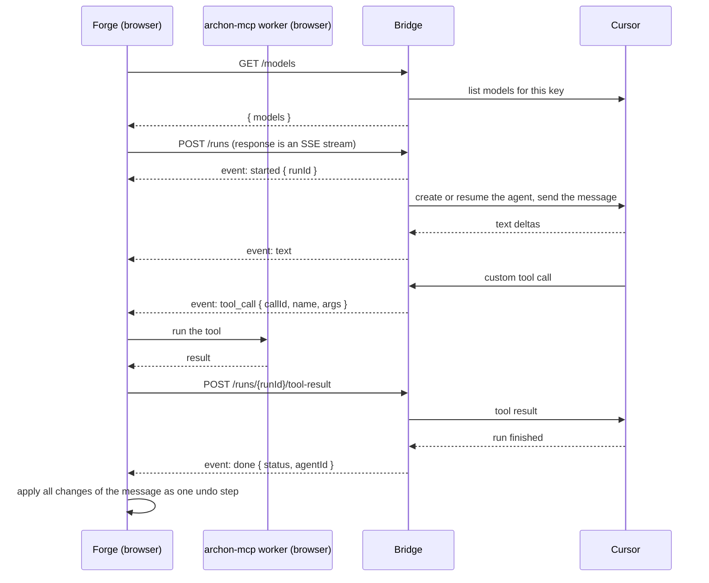

# ArchON Forge Bridge API

This is the contract between the ArchON Forge plugin and the **bridge**, the small server that runs the Cursor agent for Forge. Use it to run your own bridge, so your Cursor API key and the agent's traffic pass only through servers you control.

By default Forge uses the bridge operated by ArchON at `https://surecom.in/api/forge/cursor`. Your bridge has to implement the same four endpoints with the same behaviour. Forge itself does not change: paste your URL into **Settings → Bridge URL** and you're done.

- [Why there is a bridge](#why-there-is-a-bridge)
- [What passes through the bridge](#what-passes-through-the-bridge)
- [Connecting Forge to your bridge](#connecting-forge-to-your-bridge)
- [Protocol at a glance](#protocol-at-a-glance)
- [Rules for every endpoint](#rules-for-every-endpoint)
- [`GET /models`](#get-models)
- [`POST /runs`](#post-runs)
- [`POST /runs/{runId}/tool-result`](#post-runsrunidtool-result)
- [`POST /runs/{runId}/cancel`](#post-runsrunidcancel)
- [Running the agent](#running-the-agent)
- [Deployment](#deployment)
- [Minimal bridge (one file)](#minimal-bridge-one-file)
- [Checking a bridge with curl](#checking-a-bridge-with-curl)
- [Privacy checklist for your bridge](#privacy-checklist-for-your-bridge)

## Why there is a bridge

Forge is a browser plugin. Its Cursor provider uses the [Cursor SDK](https://cursor.com/docs/sdk/typescript), and the SDK needs Node.js: it spawns processes, writes files and uses `node:sqlite`. None of that is available in a browser. The bridge is the smallest piece of Node that closes this gap:

1. It starts a Cursor agent with the model the user picked.
2. It registers every archon-mcp tool the browser sends as an SDK **custom tool**.
3. When the agent calls a tool, the bridge does **not** run it. It relays the call to the browser over the run's event stream, waits for the browser to post the result, and gives that result back to the agent.

The tools stay in the browser, and so does the project. archon-mcp runs as a Web Worker inside the ArchON page, and Forge applies every change of a message in one undo step after the run finishes. The bridge keeps no project state and needs no ArchON code apart from this protocol.

## What passes through the bridge

| Data | Reaches the bridge? | Notes |
| --- | --- | --- |
| Cursor API key | Yes, on every request | Sent in `Authorization: Bearer …`. The bridge needs the key to call Cursor for the user. |
| System prompt, the tab's chat history, the new message | Yes, in `POST /runs` | The message starts with a `<context>` block that names the integration layer and the UI language. |
| Tool schemas | Yes, in `POST /runs` | The list of archon-mcp tools Forge allows the model to use. |
| Tool call arguments and results | Yes | Results hold whatever **parts of the project** the agent asked for: element names, descriptions, technologies, relationships. |
| Model output (text, reasoning) | Yes, streamed | |
| The project as a whole, Google Drive tokens, collaborators' data | No | The bridge sees only what the agent reads through tools. |

Two points matter if you worry about leaks:

- **The model runs at Cursor.** Cursor processes everything the agent sees (prompt, history, tool results), whichever bridge you use. Your own bridge takes the ArchON-operated server out of the path. It does not take Cursor out. If sending data to Cursor is not acceptable, wait for the on-prem provider (listed as "Coming soon").
- **The ArchON bridge keeps agent conversations on disk.** The SDK stores the agent's checkpoints, runs and run events, tool results included, in a JSONL store in a temporary directory on the bridge server. That is what lets the next message resume the same agent. On your own bridge you decide where that store lives and how long it is kept. Forge does not depend on it: if resuming fails, the bridge starts a fresh agent and sends the chat history (see [Running the agent](#running-the-agent)).

| | ArchON bridge | Your bridge |
| --- | --- | --- |
| Who receives the API key | ArchON server (memory only) and Cursor | Your server and Cursor |
| Who sees tool calls and results | ArchON server and Cursor | Your server and Cursor |
| Where agent conversations are stored | ArchON server's temp directory | Wherever you configure |
| Who controls logs and retention | ArchON operator | You |

## Connecting Forge to your bridge

1. Deploy a bridge: see [Deployment](#deployment) and the [one-file example](#minimal-bridge-one-file).
2. In the Forge window, click the settings cog and fill in **Bridge URL**.
3. Enter the **base URL**, which is the prefix Forge appends `/models`, `/runs`, … to. Any path works, for example `https://forge-bridge.example.com/api/forge/cursor` or `https://ai.corp.local/forge`. Trailing slashes are stripped.

Leave the field empty to use the ArchON bridge, `https://surecom.in/api/forge/cursor`.

The URL is saved with the rest of the Forge settings in this browser's `localStorage`, never in the project file. Every user and every browser picks its own bridge, and collaborators never see yours.

The browser enforces a few things on the URL:

- **HTTPS.** When ArchON is opened over HTTPS, the browser blocks plain `http://` requests as mixed content. `http://localhost` is the exception.
- **CORS.** The bridge must allow the origin ArchON is served from (see [CORS](#cors)).
- **Local network access.** When a public page such as `https://archon.su` calls a bridge on `localhost` or a private address, Chromium-based browsers may ask the user for permission, or expect `Access-Control-Allow-Private-Network: true` in the preflight response. A bridge on a public HTTPS hostname avoids this.

## Protocol at a glance



One chat message is one `POST /runs`. Each tool call is answered with its own `POST /runs/{runId}/tool-result` while the stream stays open. The stop button sends `POST /runs/{runId}/cancel` and drops the stream.

## Rules for every endpoint

### Authentication: bring your own key

Every request carries `Authorization: Bearer <Cursor API key>`. The protocol has no sessions, cookies or user accounts.

Why: the bridge needs the key to call Cursor for the user anyway, so the key is also the identity. Sending it with each request means the bridge never stores credentials, and a leaked `runId` is useless without the key that started the run.

- A missing or malformed header answers `401`.
- Bind every run to a hash of the key (the ArchON bridge uses SHA-256). A `tool-result` or `cancel` sent with a different key answers `404`, exactly like an unknown run, so outsiders cannot learn which runs exist.
- Never log or persist the key. Its hash is fine for bookkeeping, such as naming a workspace directory.

### Errors

Errors that happen before a stream opens are plain JSON:

```json
{ "error": "busy", "message": "Another Forge run is active for this key", "retryable": true }
```

Forge derives its error kind from the HTTP status:

| HTTP status | Error kind in Forge | What the user sees |
| --- | --- | --- |
| `401`, `403` | `auth` | Forge's own text: "The provider rejected the credentials. Check them in settings." The settings cog blinks red. |
| `409` | `busy` | Forge's own text: "Another Forge run is still active for this key. Try again in a moment." |
| `429` | `rate_limit` | "Something went wrong: {message}" |
| `5xx` | `server` | "Something went wrong: {message}" |
| Anything else (`400`, `404`, `413`) | `unknown` | "Something went wrong: {message}" |

`retryable` in the body is passed along with the error. When it is missing, Forge treats `busy`, `rate_limit`, `server` and network failures as retryable.

Report a rejected Cursor key as `401` / `auth`. Cursor SDK errors carry `name` and `status` (a rejected key is `AuthenticationError` with `status: 401`, a rate limit is `RateLimitError` with `status: 429`). Classify by those fields rather than by the message text.

### Caching

Send `Cache-Control: no-store` on JSON responses. They carry per-user data and must never be cached by a proxy.

### CORS

Forge sends `Authorization` and a JSON body, so the browser sends a preflight `OPTIONS` before each request. Answer it with `204` and:

```http
Access-Control-Allow-Origin: https://archon.su
Access-Control-Allow-Methods: GET, POST, OPTIONS
Access-Control-Allow-Headers: Authorization, Content-Type
Access-Control-Max-Age: 86400
Vary: Origin
```

Echo the request's `Origin` only when it is on your allow-list, and answer `403` without CORS headers otherwise. Forge sends no cookies, so `Access-Control-Allow-Credentials` is not needed. `Accept` is a CORS-safelisted header and does not need to be listed.

## `GET /models`

Lists the models the caller's Cursor key can use.

```http
GET /models
Authorization: Bearer key_…
```

```json
{
  "models": [
    { "id": "<model id>", "label": "<display name>", "description": "<optional text>" }
  ]
}
```

| Field | Required | Meaning |
| --- | --- | --- |
| `id` | Yes | Sent back verbatim as `model` in `POST /runs`. |
| `label` | Yes | Shown in the setup wizard. |
| `description` | No | Shown under the label. |

The setup wizard calls this endpoint when the user enters a key. It doubles as the key check, so **fail loudly**: a rejected key must answer `401`. Never return a guessed or hard-coded list. When the call fails, the wizard shows the error and still lets the user type a model id by hand.

The ArchON bridge calls `Cursor.models.list({ apiKey })` and caches the result for 5 minutes per key hash, so reopening the wizard does not hit Cursor every time.

## `POST /runs`

Runs one chat message. The response is a [Server-Sent Events](https://html.spec.whatwg.org/multipage/server-sent-events.html) stream that lasts until the agent finishes.

### Request

```http
POST /runs
Authorization: Bearer key_…
Content-Type: application/json
Accept: text/event-stream
```

```json
{
  "model": "<id from /models>",
  "agentId": "agent-id-from-the-previous-done-event",
  "retry": false,
  "systemPrompt": "You edit the user's ArchON project through the archon tools…",
  "history": [
    { "role": "user", "text": "Add a Payments system" },
    { "role": "assistant", "text": "Added Payments with an API and a database." }
  ],
  "message": "<context>\nCurrent integration layer: \"Payments flow\".\nUI language: English (en). …\n</context>\n\nConnect Orders API to Payments API",
  "tools": [
    {
      "name": "add_relationships",
      "description": "Add relationships between elements…",
      "inputSchema": { "type": "object", "properties": { "…": {} } }
    }
  ]
}
```

| Field | Type | What it is | What the bridge does with it |
| --- | --- | --- | --- |
| `model` | string, required | Model id from `/models`, or one the user typed in. | Passes it to `Agent.create` and to every `agent.send`. |
| `agentId` | string or `null` | Cursor agent id from the previous `done` event of this tab. `null` on the first message of a tab, after a page reload, after "Clear history", and after the settings change: Forge keeps it in memory only. | Tries to resume that agent. If resuming fails for **any** reason, silently starts a fresh agent. Never fail the run because of `agentId`. |
| `retry` | boolean | `true` when the user pressed Retry after a failed or cancelled message. `message` is the same text as before, and `history` excludes it. | When resuming, sends with `local.force: true` so the SDK expires a run left hanging by the failed attempt. |
| `systemPrompt` | string, required | The rules the model must follow. | Used **only** for a fresh agent: a resumed agent already has it. That is why Forge repeats the layer and the UI language in the `<context>` block of every message. |
| `history` | array | Finished exchanges of this tab, oldest first, as the user typed them (without the `<context>` block). Failed and cancelled messages are left out so they cannot steer the next one. Sent with every message. | Used **only** for a fresh agent, to rebuild the conversation. |
| `message` | string, required | The user's text, prefixed with the `<context>` block. | Sent to the agent verbatim. |
| `tools` | array, required | archon-mcp tools available in this browser, already filtered by Forge's deny-list (`auto_layout`, project load/save and similar). Each item has `name`, `description` and `inputSchema` (JSON Schema). | Registered as SDK custom tools with exactly these names and schemas. |

**Why the browser sends the tool list.** The tools come from the archon-mcp version bundled into the plugin. When the plugin ships new or changed tools, the bridge picks them up from the next request without a redeploy, and it never needs to know what any tool does. Forge also enforces its deny-list a second time when it executes a call, so a bridge cannot widen what the model may do.

### Validation limits

The ArchON bridge checks the body before opening the stream and answers `400` when a check fails:

| What | Limit |
| --- | --- |
| Request body | 2 MB |
| `message` | 1 to 60 000 characters |
| `tools` | At most 120 items and 400 000 characters of JSON. Each `name` matches `^[a-zA-Z0-9_-]{1,64}$`. |
| `history` | Every item has `role` `user` or `assistant` and a string `text`. 200 000 characters in total. |

Today's Forge requests stay far below these limits. Keep them at least this large, or Forge will start failing on big projects and long chats.

### Errors before the stream opens

These answer with plain JSON, as described in [Errors](#errors):

| Status | `error` | When |
| --- | --- | --- |
| `400` | `bad_request` | The body fails validation. |
| `401` | `auth` | The `Authorization` header is missing or malformed. |
| `409` | `busy` | Another run is already active for this key. |
| `429` | `busy` | The bridge is at its overall run limit. |

**Why one run per key.** Forge runs one message at a time per browser, across all tabs. A second concurrent run with the same key means a second browser or device, or a bug. Refusing it keeps two agents from editing on behalf of one user at once and caps how much one key can spend on your bridge.

### Stream format

Respond with `200` and these headers:

```http
Content-Type: text/event-stream; charset=utf-8
Cache-Control: no-cache, no-transform
X-Accel-Buffering: no
```

Every event is an `event:` line, a `data:` line with a JSON object, and a blank line:

```text
event: tool_call
data: {"callId":"6f0c…","name":"get_elements","args":{"type":"system"}}

```

Send a comment line such as `: ping` every 15 seconds. It keeps proxies and load balancers from closing the connection while the model thinks or while a tool result is on its way. Forge ignores comments and any event name it does not know.

**Why SSE over a `fetch` body.** The browser's `EventSource` cannot send an `Authorization` header or a POST body, so Forge reads the response stream of a normal `fetch`. A WebSocket would need its own authentication handshake and connection-upgrade support in every proxy. A plain HTTP response passes through any reverse proxy, and it fits the job: one message is one request, and dropping the request means the user cancelled.

### Events

| Event | `data` | When it is sent | What Forge does |
| --- | --- | --- | --- |
| `started` | `{ "runId": string }` | First, exactly once, before anything else. | Remembers `runId` for tool results and cancel. |
| `text` | `{ "text": string }` | A piece of the assistant's reply. | Appends it to the reply. |
| `thinking` | `{ "text": string }` | A piece of the model's reasoning. Optional. | Shows it as the "thinking" indicator. |
| `tool_call` | `{ "callId": string, "name": string, "args": object }` | The agent called a custom tool. | Runs the tool in the worker and posts the result to `/runs/{runId}/tool-result`. |
| `done` | `{ "status": "finished" \| "cancelled" \| "error", "agentId"?: string, "text"?: string }` | The run is over. Terminal. | `finished`: applies all changes of the message as one undo step. `cancelled` or `error`: discards them. Keeps `agentId` for the next message. `text` is shown as the reply when no `text` events came. |
| `error` | `{ "message": string, "code": string, "retryable": boolean }` | The run failed after the stream opened. Terminal. | Shows the error as in [Errors](#errors), with `code` in place of the HTTP status. `code: "auth"` makes the settings cog blink red. |

Forge relies on these rules:

1. **`started` comes first.** Forge cannot post a tool result before it knows the `runId`. A `tool_call` sent earlier hangs until the bridge's tool timeout.
2. **Exactly one terminal event, then close the stream.** A stream that ends without `done` or `error` is reported as "The bridge closed the stream before the run finished", a retryable network error.
3. **Only `finished` changes the project.** If you cannot tell whether the run completed, send `error`, never `finished`. This is what makes Stop and failures leave the project untouched.
4. **`error.code` is one of** `auth`, `busy`, `rate_limit`, `network`, `server` or `unknown`. Forge treats any other value like `unknown`.
5. **Include `agentId` in `done`.** Without it the next message starts a fresh agent from `history`. That still works, but it is slower and the agent loses what it learned from earlier tool results.
6. **Send `text` in `done` when nothing was streamed.** Some models return only a final result. Without it the user would see an empty reply.
7. **Tool calls are handled one at a time.** Forge reads the next event only after it has posted the result of the current tool call. If the agent issues several calls at once, send them all. Forge answers them in order, and events already sent wait in the stream.

## `POST /runs/{runId}/tool-result`

The browser's answer to a `tool_call` event.

```http
POST /runs/6007deff-…/tool-result
Authorization: Bearer key_…
Content-Type: application/json
```

```json
{ "callId": "6f0c…", "text": "Added 1 relationship: Orders API → Payments API", "isError": false }
```

| Field | Meaning |
| --- | --- |
| `callId` | The `callId` of the `tool_call` event. |
| `text` | The tool's text output. It can be large: the ArchON bridge truncates it at 400 000 characters with `…[truncated]`, and the body limit is 2 MB. |
| `isError` | `true` when the tool failed: invalid arguments, a denied tool, or the user cancelled. Hand it to the agent as a tool error so the model can correct itself. It is **not** a transport error. |

Answer `204` with no body. Forge treats any non-2xx answer as a failed message, so accept every valid result.

| Status | When |
| --- | --- |
| `400` | `callId` or `text` is missing. |
| `404` | The run is unknown, belongs to another key, or the `callId` is unknown, already answered or expired. |

**Why a separate POST.** SSE carries data in one direction only, from the bridge to the browser. Results go back as ordinary requests that are matched to the waiting tool call by `runId` and `callId`. The waiting call lives in the memory of the process that runs the agent, so this request must reach **the same process** that is serving the stream (see [Deployment](#deployment)).

**Tool timeout.** When the browser does not answer within 120 seconds, for example because the tab was closed, the bridge answers the call itself with an error result, so the agent never hangs.

## `POST /runs/{runId}/cancel`

Stops a running message. There is no body. Answer `204`, or `404` for an unknown run or a different key.

The bridge must:

1. Mark the run as cancelled.
2. Answer every pending tool call with the error result `Cancelled by the user.`
3. Call `run.cancel()` on the SDK run.
4. End the stream with `done { "status": "cancelled" }`.

Forge does not wait for the answer. It also aborts the stream's `fetch` at the same moment, so **treat a client disconnect as a cancel too**. Both are needed: some proxies only notice that the client went away on the next write, while the explicit cancel arrives at once.

The ArchON bridge keeps a finished run for 30 seconds, so a late tool result or cancel gets a clean `404` instead of being misread.

## Running the agent

None of this is visible on the wire, but it is how the ArchON bridge works, and Forge's system prompt is written for it.

**Fresh agent or resumed agent.** When `agentId` is set, try `Agent.resume(agentId, …)`. When it is not set or the resume fails, call `Agent.create(…)` and make the first message carry the rules and the conversation so far:

```text
<system_prompt>
{systemPrompt}
</system_prompt>

<conversation_history>
User: {history[0].text}

Assistant: {history[1].text}
</conversation_history>

{message}
```

Leave out the `<conversation_history>` block when `history` is empty. A resumed agent gets only `message`.

**A contained workspace.** The agent still has Cursor's built-in tools (shell, file edits), and the system prompt tells it to use only the archon tools. The workspace makes sure those built-in tools have nothing to touch:

| SDK option | Value | Why |
| --- | --- | --- |
| `local.cwd` | An empty directory per key hash | Nothing to read or edit, and different users never share a directory. |
| `local.store` | `JsonlLocalAgentStore` in a separate directory per key hash | Agent conversations for resuming. This is the data the [privacy note](#what-passes-through-the-bridge) talks about. |
| `local.settingSources` | `[]` | Ignore any Cursor rules, settings or MCP servers on the bridge host. |
| `local.sandboxOptions.enabled` | `true` | The SDK sandbox stays on. |
| `local.customTools` | One entry per item of `tools` | `execute` relays the call to the browser and waits for the result. |

**Limits and timeouts.** The ArchON bridge uses these values. They are sensible defaults for your bridge too:

| What | Value | Meaning |
| --- | --- | --- |
| Runs in flight | 4 across all keys, 1 per key | Beyond that the bridge answers `429` (overall) or `409` (same key). |
| Run timeout | 10 minutes | Longest run. When it expires, the run is stopped and the stream ends with a retryable `error`. |
| Connect timeout | 90 seconds | Limit for listing models, creating or resuming the agent, and sending the message. |
| Tool result timeout | 120 seconds | How long to wait for the browser's answer to a tool call. |
| Model list cache | 5 minutes per key | See [`GET /models`](#get-models). |
| Heartbeat | Every 15 seconds | See [Stream format](#stream-format). |
| Finished-run grace | 30 seconds | See [`POST /runs/{runId}/cancel`](#post-runsrunidcancel). |

## Deployment

- **Node.js 22.13 or newer.** This is the Cursor SDK's engine requirement.
- **Linux with glibc** (Debian, Ubuntu), not Alpine/musl. The SDK's native Linux binaries need glibc. In Docker use an image such as `node:22-bookworm-slim`.
- **One process, or routing by key.** Runs and their waiting tool calls live in memory, so `/runs/{runId}/tool-result` and `/cancel` must reach the process that serves the stream. Run one instance. If you need several, route by a hash of the `Authorization` header so every request of one key lands on the same instance.
- **Outbound HTTPS to Cursor.** The bridge talks to Cursor's API. Nothing else needs to be reachable.
- **A reverse proxy that does not buffer.** Buffering holds SSE events back until the run ends, and the user sees nothing until then. For nginx:

```nginx
location /api/forge/cursor/ {
    proxy_pass http://127.0.0.1:8787;
    proxy_http_version 1.1;
    proxy_set_header Connection "";
    proxy_buffering off;          # stream events as they come
    proxy_cache off;
    proxy_read_timeout 15m;       # longer than the run timeout
    client_max_body_size 2m;      # matches the bridge's body limit
}
```

Make sure no log format includes `$http_authorization` or request bodies.

## Minimal bridge (one file)

A self-contained bridge that implements this whole contract with Node's built-in `http` module and `@cursor/sdk`. It behaves like the ArchON bridge: the same endpoints, events, limits, timeouts and agent setup.

```sh
mkdir forge-bridge && cd forge-bridge
npm init -y && npm pkg set type=module
npm install @cursor/sdk
# save the code below as server.mjs
ALLOWED_ORIGINS=https://archon.su PORT=8787 node server.mjs
```

Then set **Bridge URL** in Forge to `http://localhost:8787/api/forge/cursor` (same machine) or to the HTTPS address of your reverse proxy.

| Environment variable | Default | Meaning |
| --- | --- | --- |
| `PORT` | `8787` | Port to listen on. |
| `BRIDGE_PREFIX` | `/api/forge/cursor` | Path prefix of the four endpoints. |
| `ALLOWED_ORIGINS` | `https://archon.su` | Comma-separated origins ArchON is served from. `*` allows any origin. |
| `DATA_DIR` | `{os.tmpdir()}/archon-forge-bridge` | Workspaces and agent stores. |
| `MAX_PARALLEL` | `4` | Runs in flight across all keys. |

```js
// Minimal ArchON Forge bridge. Node >= 22.13, `npm i @cursor/sdk`. Contract: BRIDGE.md.
import http from 'node:http';
import { createHash, randomUUID } from 'node:crypto';
import { mkdir } from 'node:fs/promises';
import os from 'node:os';
import path from 'node:path';
import { Agent, Cursor, JsonlLocalAgentStore } from '@cursor/sdk';

const PORT = Number(process.env.PORT || 8787);
const PREFIX = process.env.BRIDGE_PREFIX || '/api/forge/cursor';
const ALLOWED_ORIGINS = (process.env.ALLOWED_ORIGINS || 'https://archon.su').split(',').map(s => s.trim()).filter(Boolean);
const DATA_DIR = process.env.DATA_DIR || path.join(os.tmpdir(), 'archon-forge-bridge');
const MAX_PARALLEL = Number(process.env.MAX_PARALLEL || 4);
const CONNECT_TIMEOUT_MS = 90_000;
const RUN_TIMEOUT_MS = 10 * 60_000;
const TOOL_TIMEOUT_MS = 120_000;
const MAX_BODY_BYTES = 2 * 1024 * 1024;

class HttpError extends Error {
  constructor(status, code, message, retryable = false) {
    super(message);
    Object.assign(this, { status, code, retryable });
  }
}

const runs = new Map();        // runId → { keyHash, cancelled, run, pending: Map<callId, resolve> }
const activeKeys = new Set();  // key hashes with a run in flight

const hashOf = key => createHash('sha256').update(key).digest('hex');
const textResult = (text, isError) => ({ content: [{ type: 'text', text }], isError });

function withTimeout(promise, ms, label) {
  let timer;
  const timeout = new Promise((_, reject) => {
    timer = setTimeout(() => reject(new HttpError(504, 'network', `${label} timed out`, true)), ms);
  });
  return Promise.race([promise, timeout]).finally(() => clearTimeout(timer));
}

function classify(err) {
  if (err instanceof HttpError) return err;
  const message = err?.message ?? String(err);
  if (err?.name === 'AuthenticationError' || err?.status === 401 || err?.status === 403) return new HttpError(401, 'auth', message);
  if (err?.name === 'RateLimitError' || err?.status === 429) return new HttpError(429, 'rate_limit', message, true);
  if (err?.name === 'NetworkError' || /ECONN|ETIMEDOUT|ENOTFOUND|timed out/i.test(message)) return new HttpError(502, 'network', message, true);
  const retryable = err?.isRetryable === true;
  return new HttpError(500, retryable ? 'server' : 'unknown', message, retryable);
}

function bearer(req) {
  const match = /^Bearer\s+(\S+)\s*$/i.exec(req.headers.authorization ?? '');
  if (!match) throw new HttpError(401, 'auth', 'Missing Authorization: Bearer <Cursor API key>');
  return match[1];
}

async function readJson(req) {
  const chunks = [];
  let size = 0;
  for await (const chunk of req) {
    size += chunk.length;
    if (size > MAX_BODY_BYTES) throw new HttpError(413, 'bad_request', 'Request body is too large');
    chunks.push(chunk);
  }
  try {
    return JSON.parse(Buffer.concat(chunks).toString('utf8') || '{}');
  } catch {
    throw new HttpError(400, 'bad_request', 'Body must be JSON');
  }
}

function sendJson(res, status, body) {
  res.writeHead(status, { 'Content-Type': 'application/json' }).end(JSON.stringify(body));
}

function validateRun(b) {
  const fail = message => { throw new HttpError(400, 'bad_request', message); };
  if (typeof b?.model !== 'string' || !b.model.trim()) fail('`model` is required');
  if (typeof b.message !== 'string' || !b.message.trim() || b.message.length > 60_000) fail('`message` is missing or too long');
  if (typeof b.systemPrompt !== 'string') fail('`systemPrompt` is required');
  if (!Array.isArray(b.tools) || b.tools.length > 120) fail('`tools` must be an array of at most 120');
  if (b.tools.some(t => !/^[a-zA-Z0-9_-]{1,64}$/.test(t?.name ?? ''))) fail('Invalid tool name');
  const history = Array.isArray(b.history) ? b.history : [];
  if (history.some(h => (h?.role !== 'user' && h?.role !== 'assistant') || typeof h.text !== 'string')) fail('Invalid `history`');
  return {
    model: b.model.trim(),
    agentId: typeof b.agentId === 'string' && b.agentId ? b.agentId : null,
    retry: b.retry === true,
    systemPrompt: b.systemPrompt,
    history,
    message: b.message,
    tools: b.tools,
  };
}

function initialMessage(req) {
  const parts = [`<system_prompt>\n${req.systemPrompt.trim()}\n</system_prompt>`];
  if (req.history.length) {
    const transcript = req.history.map(h => `${h.role === 'user' ? 'User' : 'Assistant'}: ${h.text}`).join('\n\n');
    parts.push(`<conversation_history>\n${transcript}\n</conversation_history>`);
  }
  parts.push(req.message);
  return parts.join('\n\n');
}

function settle(active, text) {
  active.pending.forEach(resolve => resolve(textResult(text, true)));
  active.pending.clear();
}

async function cancel(active) {
  if (active.cancelled) return;
  active.cancelled = true;
  settle(active, 'Cancelled by the user.');
  if (active.run?.supports('cancel')) await active.run.cancel().catch(() => undefined);
}

function relayTool(active, send, name, args) {
  if (active.cancelled) return Promise.resolve(textResult('Cancelled by the user.', true));
  const callId = randomUUID();
  return new Promise(resolve => {
    const timer = setTimeout(() => {
      active.pending.delete(callId);
      resolve(textResult(`Tool ${name} did not answer within ${TOOL_TIMEOUT_MS / 1000}s.`, true));
    }, TOOL_TIMEOUT_MS);
    active.pending.set(callId, result => { clearTimeout(timer); resolve(result); });
    send('tool_call', { callId, name, args: args ?? {} });
  });
}

async function dispose(agent) {
  if (!agent) return;
  try { await agent[Symbol.asyncDispose](); } catch { try { agent.close(); } catch { /* already closed */ } }
}

async function startRun(res, apiKey, req) {
  const keyHash = hashOf(apiKey);
  if (activeKeys.has(keyHash)) throw new HttpError(409, 'busy', 'Another Forge run is active for this key', true);
  if (activeKeys.size >= MAX_PARALLEL) throw new HttpError(429, 'busy', 'The bridge is busy, try again shortly', true);
  activeKeys.add(keyHash);
  const active = { id: randomUUID(), keyHash, cancelled: false, run: null, pending: new Map() };
  runs.set(active.id, active);

  res.writeHead(200, {
    'Content-Type': 'text/event-stream; charset=utf-8',
    'Cache-Control': 'no-cache, no-transform',
    'X-Accel-Buffering': 'no',
    Connection: 'keep-alive',
  });
  const send = (event, data) => { if (!res.writableEnded) res.write(`event: ${event}\ndata: ${JSON.stringify(data)}\n\n`); };
  const heartbeat = setInterval(() => { if (!res.writableEnded) res.write(': ping\n\n'); }, 15_000);
  res.on('close', () => { if (!res.writableFinished) void cancel(active); });
  send('started', { runId: active.id });

  let agent;
  try {
    const root = path.join(DATA_DIR, keyHash.slice(0, 32));
    const cwd = path.join(root, 'workspace');
    const storeDir = path.join(root, 'store');
    await mkdir(cwd, { recursive: true });
    await mkdir(storeDir, { recursive: true });
    const customTools = Object.fromEntries(req.tools.map(tool => [tool.name, {
      description: tool.description,
      inputSchema: tool.inputSchema,
      execute: args => relayTool(active, send, tool.name, args),
    }]));
    const local = {
      cwd,
      settingSources: [],
      store: new JsonlLocalAgentStore(storeDir),
      sandboxOptions: { enabled: true },
      customTools,
    };

    let fresh = false;
    if (req.agentId) {
      agent = await withTimeout(Agent.resume(req.agentId, { apiKey, local }), CONNECT_TIMEOUT_MS, 'Resuming the agent')
        .catch(() => undefined);
    }
    if (!agent) {
      agent = await withTimeout(Agent.create({ apiKey, model: { id: req.model }, name: 'Archon Forge', local }), CONNECT_TIMEOUT_MS, 'Starting the agent');
      fresh = true;
    }
    if (active.cancelled) {
      send('done', { status: 'cancelled', agentId: agent.agentId });
      return;
    }

    let streamed = 0;
    const run = await withTimeout(agent.send(fresh ? initialMessage(req) : req.message, {
      model: { id: req.model },
      local: { customTools, force: req.retry && !fresh },
      onDelta: ({ update }) => {
        if (update.type === 'text-delta' && update.text) {
          streamed += update.text.length;
          send('text', { text: update.text });
        } else if (update.type === 'thinking-delta' && update.text) {
          send('thinking', { text: update.text });
        }
      },
    }), CONNECT_TIMEOUT_MS, 'Sending the message');
    active.run = run;
    if (active.cancelled && run.supports('cancel')) await run.cancel().catch(() => undefined);

    const result = await withTimeout(run.wait(), RUN_TIMEOUT_MS, 'The agent run').catch(async err => {
      if (run.supports('cancel')) await run.cancel().catch(() => undefined);
      throw err;
    });
    const status = active.cancelled ? 'cancelled' : result.status === 'finished' ? 'finished' : result.status === 'cancelled' ? 'cancelled' : 'error';
    if (status === 'error') {
      send('error', { message: result.result || 'The agent run failed', code: 'server', retryable: true });
    } else {
      send('done', { status, agentId: agent.agentId, text: streamed === 0 && result.result ? result.result : undefined });
    }
  } catch (err) {
    if (active.cancelled) {
      send('done', { status: 'cancelled', agentId: agent?.agentId });
    } else {
      const { message, code, retryable } = classify(err);
      send('error', { message, code, retryable });
    }
  } finally {
    clearInterval(heartbeat);
    settle(active, 'The run has ended.');
    await dispose(agent);
    activeKeys.delete(keyHash);
    setTimeout(() => runs.delete(active.id), 30_000);
    res.end();
  }
}

function submitToolResult(active, body) {
  const { callId, text, isError } = body ?? {};
  if (typeof callId !== 'string' || typeof text !== 'string') throw new HttpError(400, 'bad_request', '`callId` and `text` are required');
  const resolve = active.pending.get(callId);
  if (!resolve) throw new HttpError(404, 'not_found', 'Unknown or expired tool call');
  active.pending.delete(callId);
  resolve(textResult(text.length > 400_000 ? `${text.slice(0, 400_000)}\n…[truncated]` : text, isError === true));
}

function applyCors(req, res) {
  const origin = req.headers.origin;
  res.setHeader('Vary', 'Origin');
  if (!origin || !(ALLOWED_ORIGINS.includes('*') || ALLOWED_ORIGINS.includes(origin))) return false;
  res.setHeader('Access-Control-Allow-Origin', origin);
  res.setHeader('Access-Control-Allow-Methods', 'GET, POST, OPTIONS');
  res.setHeader('Access-Control-Allow-Headers', 'Authorization, Content-Type');
  res.setHeader('Access-Control-Max-Age', '86400');
  return true;
}

http.createServer(async (req, res) => {
  const allowed = applyCors(req, res);
  if (req.method === 'OPTIONS') return res.writeHead(allowed ? 204 : 403).end();
  res.setHeader('Cache-Control', 'no-store');
  const { pathname } = new URL(req.url, 'http://bridge');
  const route = pathname.startsWith(PREFIX) ? pathname.slice(PREFIX.length) : '';
  try {
    const apiKey = bearer(req);
    if (req.method === 'GET' && route === '/models') {
      const models = await withTimeout(Cursor.models.list({ apiKey }), CONNECT_TIMEOUT_MS, 'Listing models');
      return sendJson(res, 200, { models: models.map(m => ({ id: m.id, label: m.displayName ?? m.id, description: m.description })) });
    }
    if (req.method === 'POST' && route === '/runs') return await startRun(res, apiKey, validateRun(await readJson(req)));
    const match = /^\/runs\/([^/]+)\/(tool-result|cancel)$/.exec(route);
    if (req.method === 'POST' && match) {
      const active = runs.get(decodeURIComponent(match[1]));
      if (!active || active.keyHash !== hashOf(apiKey)) throw new HttpError(404, 'not_found', 'Unknown run');
      if (match[2] === 'cancel') await cancel(active);
      else submitToolResult(active, await readJson(req));
      return res.writeHead(204).end();
    }
    throw new HttpError(404, 'not_found', 'No such route');
  } catch (err) {
    const { status, code, message, retryable } = classify(err);
    if (!res.headersSent) sendJson(res, status, { error: code, message, retryable });
    else res.end();
  }
}).listen(PORT, () => console.log(`Forge bridge on http://localhost:${PORT}${PREFIX}`));
```

## Checking a bridge with curl

```sh
BRIDGE=http://localhost:8787/api/forge/cursor
KEY=key_...            # your Cursor API key

# CORS preflight: expect 204 with Access-Control-Allow-Origin
curl -i -X OPTIONS "$BRIDGE/runs" \
  -H 'Origin: https://archon.su' \
  -H 'Access-Control-Request-Method: POST' \
  -H 'Access-Control-Request-Headers: authorization,content-type'

# Models: expect {"models":[…]}; a wrong key must answer 401 with "error":"auth"
curl -s "$BRIDGE/models" -H "Authorization: Bearer $KEY"

# One run with an `echo` tool: watch for started → tool_call → … → done
curl -N -X POST "$BRIDGE/runs" \
  -H "Authorization: Bearer $KEY" -H 'Content-Type: application/json' \
  -d '{"model":"<id from /models>","agentId":null,"retry":false,
       "systemPrompt":"Call the echo tool once, then reply with its result.",
       "history":[],"message":"Go",
       "tools":[{"name":"echo","description":"Returns a fixed string","inputSchema":{"type":"object","properties":{}}}]}'

# In a second terminal, answer the tool_call with the runId and callId from the stream
curl -i -X POST "$BRIDGE/runs/<runId>/tool-result" \
  -H "Authorization: Bearer $KEY" -H 'Content-Type: application/json' \
  -d '{"callId":"<callId>","text":"pong","isError":false}'
```

Then do the same from Forge: set **Bridge URL**, send a small message such as "Rename Orders API to Order Service", and check that the change shows up and Cmd/Ctrl+Z reverts it in one step.

## Privacy checklist for your bridge

- [ ] Allow only your ArchON origins in CORS.
- [ ] Never log the `Authorization` header, request or response bodies, or the SSE payloads, either in the bridge or in the proxy in front of it.
- [ ] Put the agent store directory (`DATA_DIR` in the example) on `tmpfs` or an encrypted volume, and clean it on a schedule. It holds agent conversations, tool results included.
- [ ] Keep the SDK sandbox on and the agent workspace empty.
- [ ] Serve the bridge over TLS.
- [ ] Limit who can reach the bridge, for example with a VPN or an IP allow-list. Forge sends no credentials other than the Cursor key, so an open bridge is free compute for anyone who has a Cursor key.
